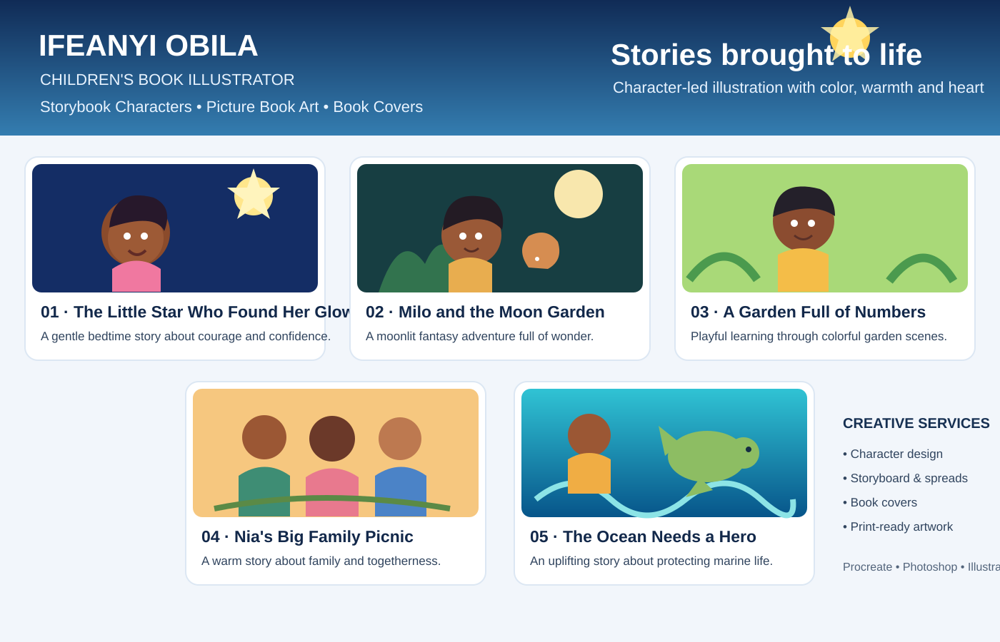

# Children's Book Illustration Portfolio

**Obila I. — Children's Book Illustrator | Storybook Characters & Picture Book Art**

I create expressive storybook characters, picture-book scenes, covers, storyboards and print-ready illustrations for authors, self-publishers and educators.

**Tools:** Procreate, Adobe Photoshop and Adobe Illustrator  
**Illustration direction:** Warm watercolor-inspired digital art, readable compositions, expressive characters and consistent visual storytelling.

## Portfolio showcase

> **Portfolio transparency:** The five entries in this folder are concept projects created to demonstrate my creative approach. They are not presented as commissioned client work, published books, testimonials or measured commercial results. Replace or supplement them with original finished artwork and real project details as those become available.

## Selected concept projects

1. [The Little Star Who Found Her Glow](01-little-star.md) — bedtime picture book and character development
2. [Milo and the Moon Garden](02-moon-garden.md) — fantasy adventure and full-page spreads
3. [A Garden Full of Numbers](03-counting-garden.md) — educational early-learning picture book
4. [Nia's Big Family Picnic](04-family-picnic.md) — warm, inclusive family story
5. [The Ocean Needs a Hero](05-ocean-hero.md) — children's environmental story

## Typical illustration process

1. Review the manuscript, audience, page count and visual references.
2. Develop character concepts and a consistent model sheet.
3. Plan page compositions with thumbnails or a storyboard.
4. Refine approved sketches into finished color illustrations.
5. Prepare final page art and cover files to the agreed print or digital specifications.

## Services

- Character design and character sheets
- Storyboards, thumbnails and page layouts
- Full-page and double-page picture-book spreads
- Front and back book covers
- Activity-book and early-reader illustrations
- Print-ready illustration files for self-publishing workflows

[Upwork profile](https://www.upwork.com/freelancers/~01e4d79a13eb9f37d8)
